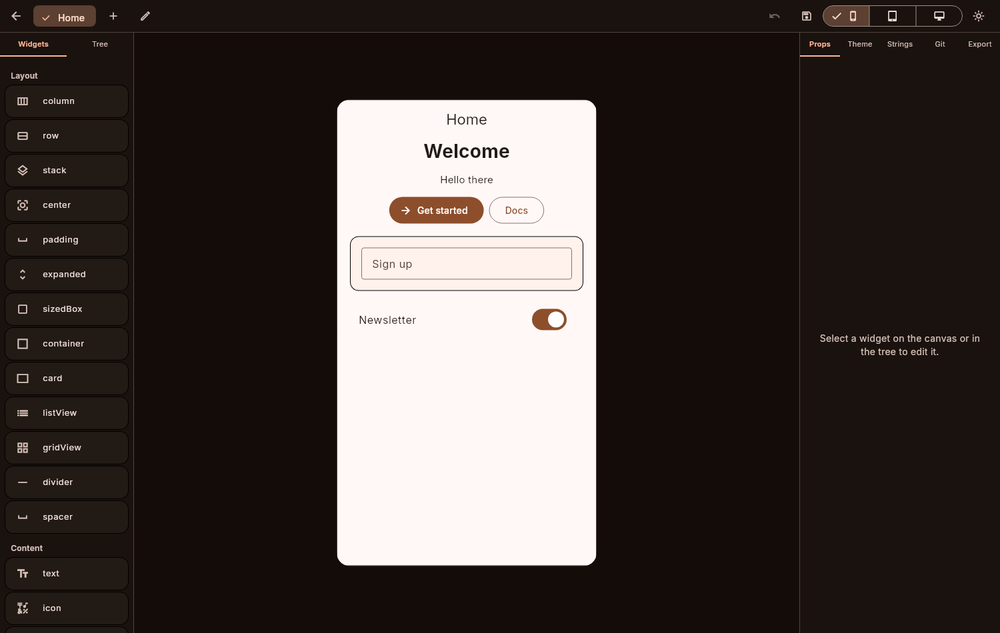
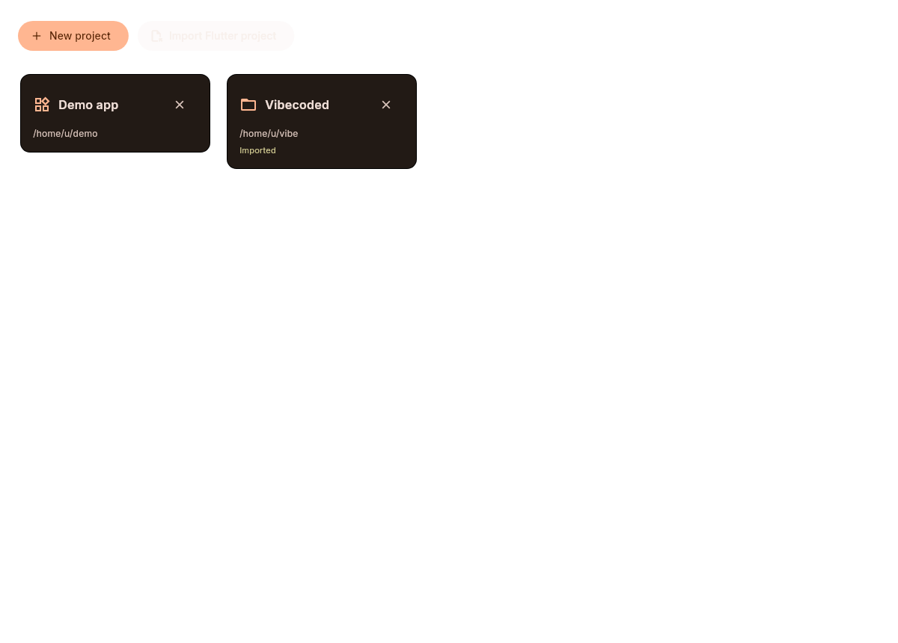

# Sunset

[](https://gitlab.com/HttpAnimations/sunset/-/pipelines)
[](https://gitlab.com/HttpAnimations/sunset/-/releases)
[](https://httpanimations.gitlab.io/sunset/)
[](LICENSE)

**Landing page:** https://httpanimations.gitlab.io/sunset/

A visual builder for Flutter apps. Drop widgets onto a canvas, style them, manage screens, locales and git history, and export a real Flutter project. Everything works without writing code, and everything the GUI does is also in the CLI so scripts and agents can build the same projects.

## What it does

- Drag-and-drop canvas with a live preview of real Flutter widgets
- Widget tree, inspector and palette for every catalog widget
- Multiple screens per project with responsive device presets
- Theme editor: seed color, brightness, radius, package name
- Built-in localization: locales and string keys managed in-app
- Built-in git: init, status, commit and log without leaving the editor
- Import existing Flutter projects, hand-written or generated
- Export generates clean Dart you can keep editing by hand
- `sunset` CLI with the same project model for headless work
- Custom macOS-style window chrome on all desktop platforms

## Install

Flatpak (recommended for Linux, one line):

```sh
flatpak install https://httpanimations.gitlab.io/sunset/sunset.flatpakref
```

Or grab packages for Windows, macOS and Linux from [GitLab Releases](https://gitlab.com/HttpAnimations/sunset/-/releases).

AltStore source (iOS):

```
https://gitlab.com/HttpAnimations/sunset/-/raw/main/repos/altstore.json
```

## Screenshots






## Repos

- **GitLab (source of truth):** https://gitlab.com/HttpAnimations/sunset
- **GitHub (CI mirror):** https://github.com/justacalico/sunset

Code lives on GitLab, builds run on the GitHub mirror, and releases are published back to GitLab.

## License

AGPL-3.0. See [LICENSE](LICENSE).
